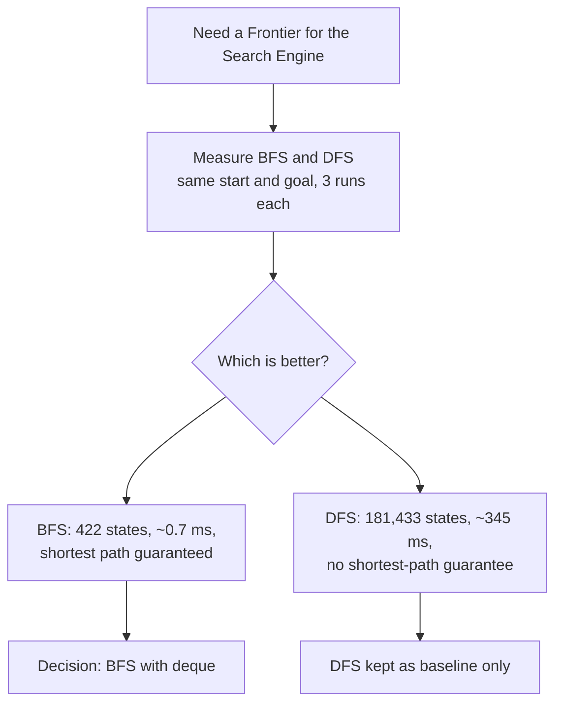

# SLE-4: Final Viva & Architecture Decision Record (ADR)

**Course:** 02AML204 – Introduction to Artificial Intelligence
**Author:** Aayaan Dheeraj Kalawant · PRN 25UAM016
**Class:** S.Y. CSE (AIML), Division A · DKTE Ichalkaranji
**ADR date:** 06 October 2026
**Deliverable:** `SLE4_25UAM016.docx`

---

## 1. What this is

The closing document of the 8-puzzle series. It records one important design decision, **using Breadth-First Search (BFS) as the primary search strategy**, together with the evidence behind it, a summary of the SLE journey, an AI contribution note, and viva preparation notes.

## 2. Document structure

| Part | Content |
|---|---|
| A | Architecture Decision Record (ADR) |
| B | Short summary of the SLE-1 to SLE-4 journey |
| C | AI contribution note |
| D | Viva preparation notes |

## 3. Part A: the ADR at a glance

**Title:** Use of BFS as the Primary Search Strategy for the 8-Puzzle Solver
**Status:** Accepted

- **Context:** The Search Engine container from SLE-3 needed a concrete Frontier / Open List: a queue or a stack. That choice decides whether the system explores level by level (BFS) or branch by branch (DFS).
- **Decision:** BFS with a FIFO deque as the Frontier. DFS stays in the codebase only as a comparison baseline.
- **Alternatives considered:**
  - Depth-First Search (LIFO stack), kept as the measured baseline.
  - Greedy Best-First Search (Manhattan-distance heuristic), not guaranteed to find the shortest path.
  - Iterative Deepening DFS, which gets BFS-like optimality with DFS-like memory but re-expands states many times.
- **Why not Greedy or IDDFS:** they add a heuristic or a repeated-search loop, which was out of scope for the uninformed-search comparison SLE-2 asked for.

## 4. Evidence (from SLE-2)

Start state `2 5 0 / 1 7 3 / 4 8 6`, goal state `1 2 3 / 4 5 6 / 7 8 0`, timed with `time.perf_counter()` over 3 runs.

| | BFS | DFS |
|---|---|---|
| States expanded | 422 | 181,433 |
| Average time | about 0.5–0.7 ms | about 345–378 ms |
| Solution depth | 10 moves | 10 moves |

DFS expanded roughly 430 times more states and ran roughly 500 times slower.

## 5. Consequences

**Positive**
- Guaranteed shortest solution on an unweighted puzzle.
- Far fewer states expanded and far less time in practice.
- Predictable behavior: it does not depend on the order neighbors are generated.

**Trade-offs**
- Higher memory use: O(b^d) for BFS against O(bm) for DFS.
- No heuristic guidance. On a harder, deeper puzzle, A* would likely beat both.
- DFS remains in the code only as a baseline, which is dead weight for the final solver.

## 6. Architectural impact

The decision touches only the **Frontier / Open List** component inside the Search Engine container (SLE-3, Level 3). Swapping the deque for a stack is the entire code change needed to turn BFS into DFS. That is why this was the one choice worth recording as an ADR.

## 7. Part B: the SLE journey

| SLE | Work done |
|---|---|
| 1 | Built the solver: `neighbors()`, `bfs()`, `dfs()`, `build_path()`, with tuple states |
| 2 | Profiled both algorithms (`perf_counter()` plus a node counter); produced the 422 vs 181,433 numbers |
| 3 | Mapped the code onto the four C4 levels; found the Frontier to be where BFS vs DFS lives |
| 4 | Turned the measurements into a defensible ADR for choosing BFS |

## 8. Part D: viva quick answers

- **Why BFS over DFS?** It explores level by level, so it guarantees the shortest path on an unweighted puzzle. SLE-2 backs this up: 422 vs 181,433 states, about 0.7 ms vs about 345 ms.
- **What changes for a larger puzzle?** BFS memory grows as O(b^d), so a deep solution could run out of memory. That is where a heuristic search such as A* becomes worth adding.
- **Container diagram in one minute:** Input Module sets START/GOAL, the Search Engine runs `bfs()`/`dfs()`, the Memory/Visited Set tracks seen states, and the Output Module prints the result. The Benchmark/Profiler wraps the engine with timing, and the Report Generator turns the numbers into documents.
- **AI vs me:** AI drafted the structure and wording. I supplied the real decision and numbers, and checked every claim against my own code and SLE-2 run.
- **Closing line:** I chose BFS because it is the only one of my two implemented strategies that is both provably optimal and, on my own measured data, hundreds of times faster for this puzzle.

## 9. AI contribution

- **Tools:** ChatGPT (SLE-1/2 code and report), Claude (SLE-3 C4 diagrams and this ADR).
- **AI helped with:** structuring the ADR, connecting the SLE-2 numbers and SLE-3 reasoning into one rationale, drafting wording.
- **I did myself:** made the BFS-over-DFS decision, ran the SLE-2 experiment, and reviewed the ADR so I can defend every number and claim.

## 10. Related files

- SLE-3: C4 architecture (see `README_SLE3.md`)
